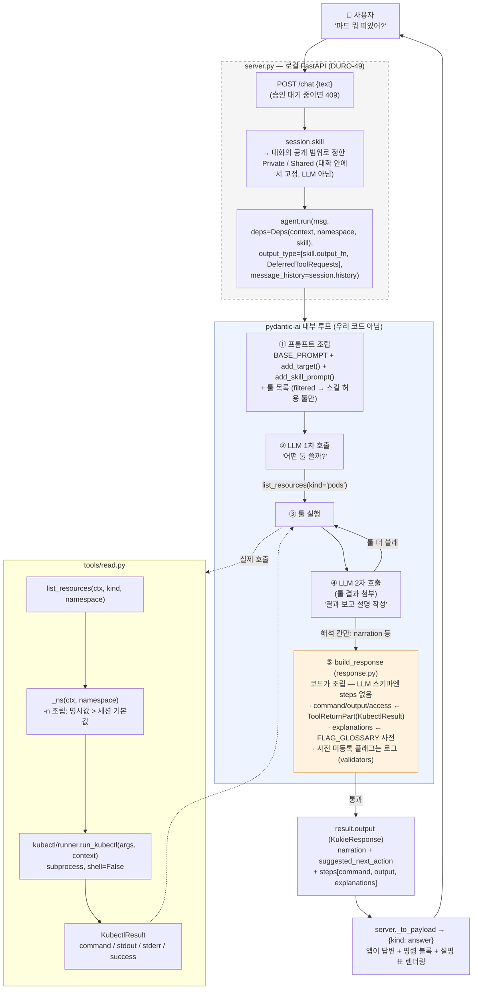
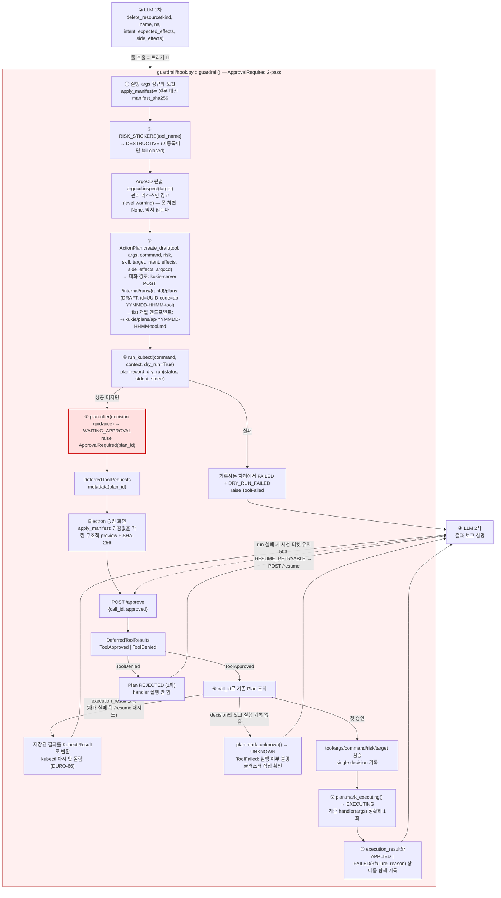
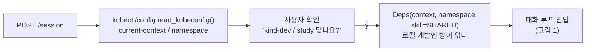

# Kukie 에이전트 호출 흐름 (함수 단위)

> 기준: 가드레일 v2 코드 + PR #18/#19 (2026-08-18). "파드 뭐 떠있어?" 한 문장이 처리되는 전 과정.
> 범례: 실선 = 우리 코드 / 점선 = pydantic-ai 내부(우리가 안 짬) / 회색 = 미구현

## 1. 전체 흐름 (읽기 요청)

## 2. 변경 요청일 때 — ③에 훅이 끼어듦

성공한 dry-run 뒤 승인 전에 decision guidance용 LLM 호출이 한 번 발생한다.

## 3. 세션 시작 (server.py)

## 4. 함수 → 파일 매핑

| 단계 | 함수 | 파일 | 상태 |
|---|---|---|---|
| 세션 시작 | `start_session()`, `read_kubeconfig()` | `server.py`, `kubectl/config.py` | ✅ DURO-49 |
| 채팅·결과 분기·승인 재개 | `chat()`, `_to_payload()`, `approve()` | `server.py` | ✅ DURO-49 + #27 승인 연결 |
| 렌더링 | — | 앱 (2단계) | ❌ |
| 스킬 결정 | `skill_for(room.shared)` | `skills/__init__.py`, `conversations.py` | ✅ DURO-100 (공개 범위로 고정, 모드 없음) |
| 에이전트 설정 | `Agent(...)`, `add_target()`, `add_skill_prompt()` | `agent.py` | ✅ |
| 툴 등록 | `FunctionToolset([*READ_TOOLS, *MUTATE_TOOLS, *GITOPS_TOOLS]).filtered(_only_skill_tools)` | `agent.py` | ✅ 스킬별 필터; 변경 4종·PR 길 1종은 Shared 만 + Hook |
| 읽기 툴 5종 | `list_resources` 등 | `tools/read.py` | ✅ |
| 변경 툴 4종 | `delete_resource` 등 | `tools/mutate.py` | ✅ Shared 대화에만 노출, 가드레일 훅 대상 |
| PR 길 변경 툴 | `propose_git_change` — 승인 전 PR, 승인 = 머지, sync·health 지켜보기, 승인 순간 STALE 판단 | `tools/gitops.py`, `guardrail/gitops_hook.py`, `gitops/` | ✅ DURO-134 |
| 명령 조립 | `assemble()` | `kubectl/assemble.py` | 부분 (apply TODO) |
| 실행 | `run_kubectl()` | `kubectl/runner.py` | ✅ |
| 훅 파이프라인 | `guardrail()` | `guardrail/hook.py` | ✅ 2-pass 승인·실행·기록 |
| Action Plan | `create_draft()`, `offer()`, `approve_for_execution()`, `mark_executing()`, `record_execution()` — 대화 경로는 kukie-server 의 plan 동작, 다음 상태는 server 가 정한다 | `guardrail/action_plan.py` → `server_api.py` | ✅ DURO-113 |
| 저장·권한 판단 | 대화 컨텍스트·run·plan·클러스터 연결 정보 — kukie-server `/internal/**` (agent 는 DB 없음) | `server_api.py` | ✅ DURO-113 |
| 클러스터 | 실행 직전 `GET /internal/clusters/{id}/connection` → 임시 kubeconfig (등록·암호화는 kukie-server) | `clusters/` | ✅ |
| 승인 | `DeferredToolRequests → Electron → /approve → DeferredToolResults` | `server.py`, `guardrail/approval.py` | ✅ #27 |
| 응답 조립 (steps·설명) | `build_response_for()`, `collect_steps()` + `FLAG_GLOSSARY` | `response.py`, `glossary.py` | ✅ DURO-44 |
| 사전 미등록 플래그 로그 | `log_unregistered_flags()` | `validators.py` | ✅ DURO-44 |
| LLM 왕복 루프 | — | pydantic-ai 내부 | (우리 코드 아님) |

## 5. 누가 뭘 결정하나

| 결정 | 주체 | 시점 |
|---|---|---|
| 어떤 스킬 | 코드 (`skill_for` — 방의 공개 범위) | 방을 열 때 |
| 어떤 툴, 어떤 값, intent | LLM | ② (1차 호출) |
| kubectl 명령 문장 | 코드 (`assemble` / 툴 내부) | ③ |
| 위험도 | 코드 (`RISK_STICKERS`) | 훅 ② |
| 실행 여부 | 사람 (승인 화면) | 훅 ⑤ |
| 명령·결과 (steps 사실 칸) | 코드 (`collect_steps` — 실행 기록 그대로) | ⑤ |
| 설명 (explanations) | 코드 (`FLAG_GLOSSARY` 사전) | ⑤ |
| 해석 (narration, 다음 행동 안내) | LLM | ④ (2차 호출) |

`suggested_next_action: str | None = None`은 현재 답변과 실행 결과에 근거한 짧은 다음 행동 안내다.
추가 행동이 필요하지 않으면 `null`이다. 제안 자체는 작업을 실행하거나 사용자 승인을 대신하지 않는다.
변경 작업의 승인·거절은 기존 `/approve` 절차를 따른다.

학습/진단/실습 모드는 없앴다 (DURO-100). Private 대화는 읽기 5종만, Shared 대화는 읽기 5종 + 변경 4종을 받는다.
공개 범위는 대화 안에서 바뀌지 않으므로 한 대화의 툴 목록·응답 스키마·지시문은 턴마다 같다 (프롬프트 캐시).
`/mode …` 입력은 모드 버튼이 남은 옛 앱을 위해서만 받아 `{kind: "mode", known: false}` 로 답하고 아무것도 바꾸지 않는다.

API 변경(#48): 기존 `suggested_transition`을 참조하는 소비자는 `suggested_next_action`으로 변경해야 한다.
구 필드는 응답에 함께 제공하지 않는다.
